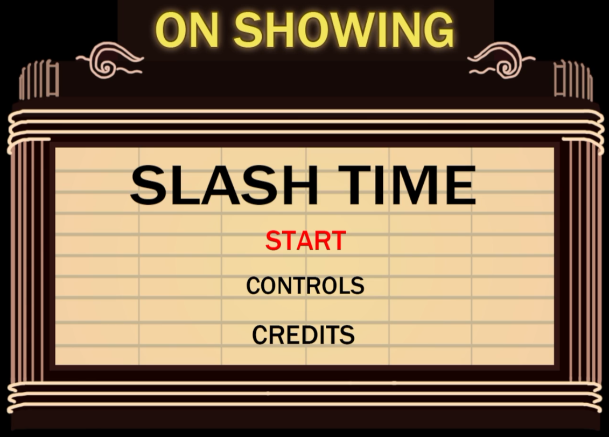
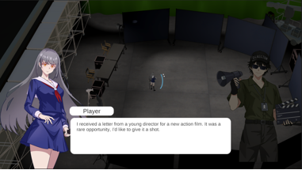
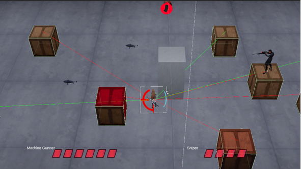
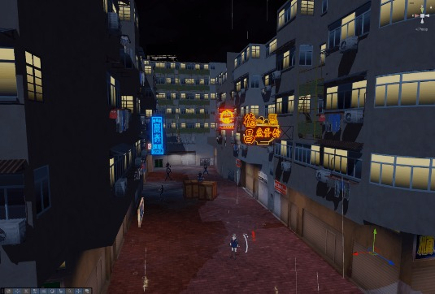

# Slash Time

**English** | [简体中文](README.zh-CN.md)

Slash Time is a top-down action game our student team made in Unity. You play an actress on the set of a new action film, and your only weapon is a katana. To get the "perfect shot" you have to clear every enemy, using dashes, slow motion and bullet parries to stay alive.

> This repository has the gameplay scripts only. Models, animations, characters, scenes, audio and third-party assets are left out, so you can't open or run the project from here. The gameplay video below shows the game in action.

## Gameplay video

[](https://www.bilibili.com/video/BV13coWBFEyX/)

▶ [【团队游戏项目】SlashTime - Perfect Shot (Bilibili)](https://www.bilibili.com/video/BV13coWBFEyX/)

## Screenshots

| Dialogue | Boss fight (debug view) |
|---|---|
|  |  |
| Main menu | Hong Kong street |
|  |  |

## Features

- Slow motion runs on an energy bar that drains while time is slowed and refills afterwards.
- The dash has 2 charges and a cooldown, with its own animation and trail.
- Katana slashes use auto aim, and you can parry enemy bullets.
- You can pick up objects and throw them at enemies.
- Enemies show aim lines and warnings before they attack.
- Regular enemies include knife-wielding thugs, boxers and gunners.
- In the boss fight, a Machine Gunner and a Sniper attack together while you use crates as cover.
- Story dialogue is loaded from JSON and shown with character portraits.
- There is a tutorial level, checkpoints, a quick restart, and a death count on the end screen.

## Controls

| Action | Keyboard & mouse | Gamepad |
|---|---|---|
| Move | WASD / Arrow keys | Left stick |
| Attack | Left mouse button | X / □ (West) |
| Dash | Space | Right trigger |
| Slow motion | Shift | Left trigger |
| Interact / Pick up | E | B / ○ (East) |
| Restart level | ; | Not bound |
| Pause | Esc | Start |

## Code structure

```
Scripts/
├── Player/          # Movement, dash, slow motion, katana, camera, audio
├── Enemy/           # Melee enemies (knife thug, boxer)
├── EnemyShooter/    # Ranged enemies and bullets (parryable)
├── Boss/            # Machine Gunner and Sniper boss, boss HP UI, crates
├── Level/           # GameManager, checkpoints, scene changes, throwables
├── DIalog/          # JSON-driven dialogue system and dialogue data
├── UI/              # Main menu and in-game UI
├── Tutorial Level/  # Training dummy
├── EnemyTelegraph.cs
└── IDamageable.cs   # Shared damage interface
```

## Built with

- Unity 6 (6000.3.2f1), C#
- Unity Input System
- Universal Render Pipeline

## Team

| Member | Role |
|---|---|
| Jiaqi Li | Designer |
| Boshanxiao Wei | Producer, 3D Artist |
| Botian Xing | 2D Artist |
| Larry | Engineer |

## License

The source code in this repository is under the [MIT License](LICENSE).
The license does not cover the screenshots or the gameplay video. All art, models, animations and audio belong to their creators and are not included here.
