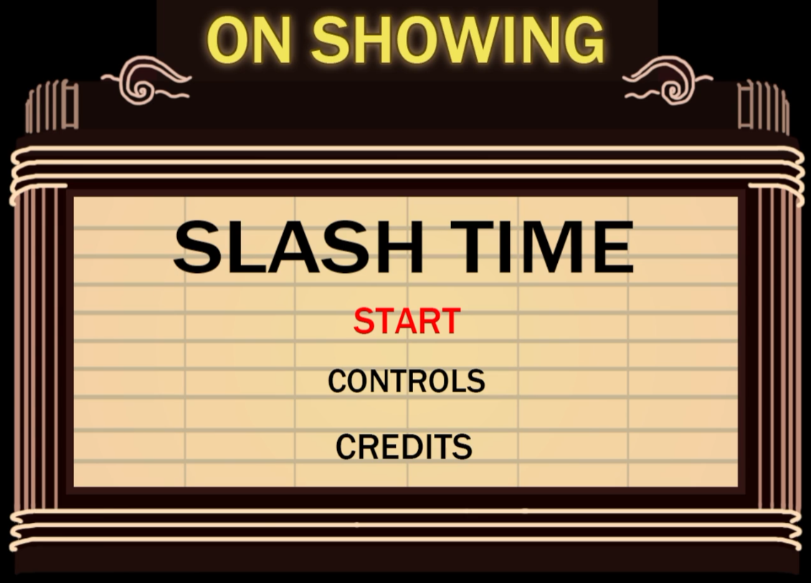
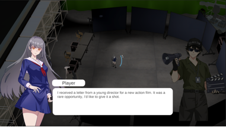
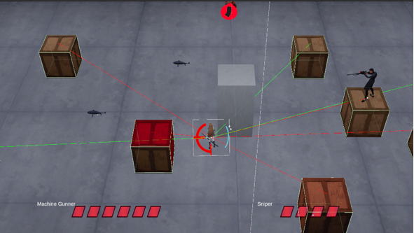
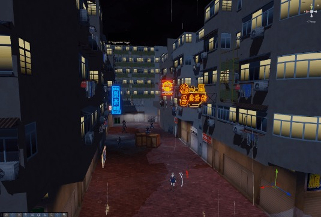

# Slash Time

[English](README.md) | **简体中文**

Slash Time 是我们学生团队用 Unity 制作的俯视角动作游戏。你扮演一名女演员，在一部新动作片的片场里，手上只有一把武士刀。想拍出"完美的一镜"，就得清光所有敌人，靠冲刺、慢动作和弹反子弹活下来。

> 本仓库只包含游戏脚本。模型、动画、角色、场景、音频和第三方素材都没有放进来，所以无法直接打开或运行工程。可以看下面的演示视频了解游戏。

## 演示视频

[](https://www.bilibili.com/video/BV13coWBFEyX/)

▶ [【团队游戏项目】SlashTime - Perfect Shot（B 站）](https://www.bilibili.com/video/BV13coWBFEyX/)

## 截图

| 剧情对话 | Boss 战（开发视角） |
|---|---|
|  |  |
| 主菜单 | 香港街景 |
|  |  |

## 游戏特色

- 慢动作消耗能量条，减速期间持续消耗，结束后慢慢回满。
- 冲刺有 2 次充能和冷却时间，带专门的动画和拖尾。
- 武士刀斩击带自动瞄准，还能弹反敌人的子弹。
- 可以捡起场景里的物品扔向敌人。
- 敌人攻击前会显示瞄准线和预警。
- 普通敌人有持刀混混、拳击手和枪手。
- Boss 战里机枪手和狙击手同时进攻，你需要借助箱子做掩体。
- 剧情对话从 JSON 读取，配有角色立绘。
- 包含教学关、存档点、快速重开，结算画面会显示死亡次数。

## 操作方式

| 动作 | 键盘鼠标 | 手柄 |
|---|---|---|
| 移动 | WASD / 方向键 | 左摇杆 |
| 攻击 | 鼠标左键 | X / □（西键） |
| 冲刺 | 空格 | 右扳机 |
| 慢动作 | Shift | 左扳机 |
| 交互 / 拾取 | E | B / ○（东键） |
| 重开本关 | ; | 未绑定 |
| 暂停 | Esc | Start |

## 代码结构

```
Scripts/
├── Player/          # 移动、冲刺、慢动作、武士刀、相机、音效
├── Enemy/           # 近战敌人（持刀混混、拳击手）
├── EnemyShooter/    # 远程敌人和可弹反的子弹
├── Boss/            # 机枪手和狙击手 Boss、Boss 血条 UI、箱子掩体
├── Level/           # GameManager、存档点、场景切换、投掷物
├── DIalog/          # JSON 驱动的对话系统和对话数据
├── UI/              # 主菜单和游戏内 UI
├── Tutorial Level/  # 训练木桩
├── EnemyTelegraph.cs
└── IDamageable.cs   # 通用受伤接口
```

## 技术栈

- Unity 6（6000.3.2f1），C#
- Unity Input System
- Universal Render Pipeline（URP）

## 团队成员

| 成员 | 职责 |
|---|---|
| Jiaqi Li | 策划 |
| Boshanxiao Wei | 制作人、3D 美术 |
| Botian Xing | 2D 美术 |
| Larry | 程序 |

## 许可证

本仓库的源代码采用 [MIT 许可证](LICENSE)。
截图和演示视频不在许可范围内。所有美术、模型、动画和音频归各自作者所有，未包含在本仓库中。
